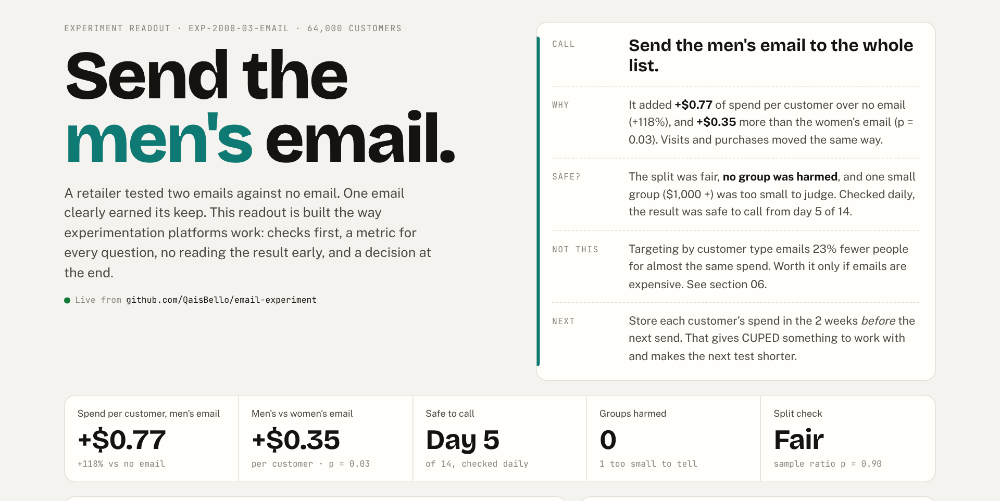
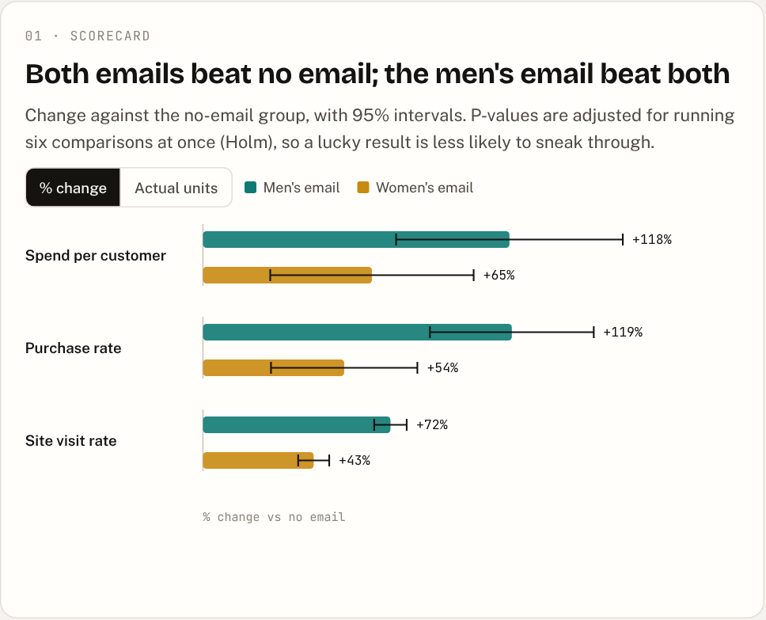
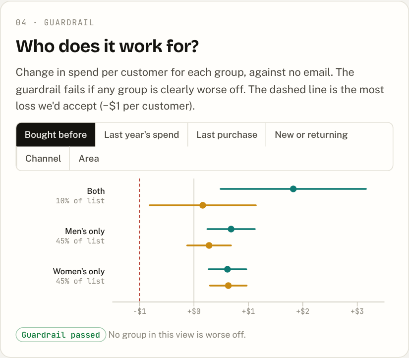
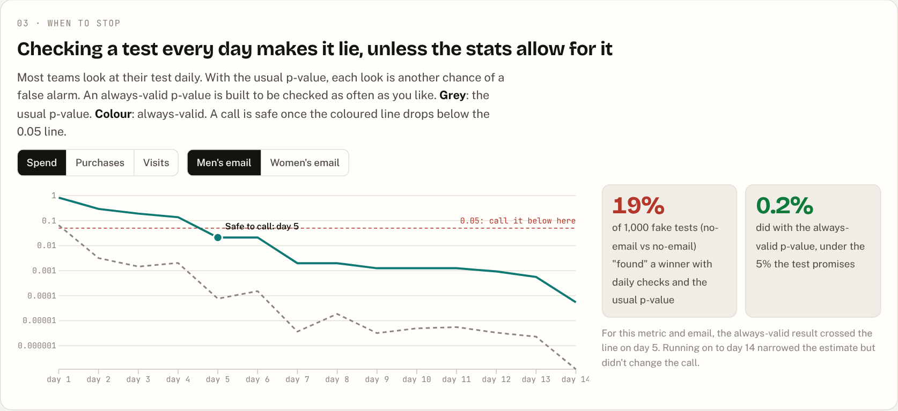
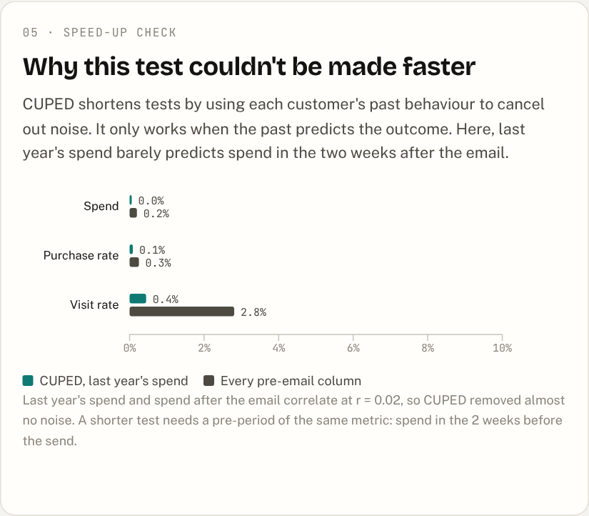
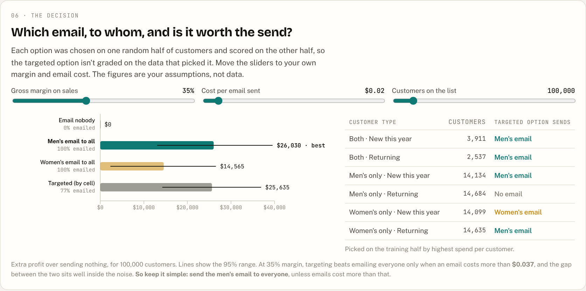

# Send the men's email. An experiment readout, platform-style

**A retailer emailed 64,000 customers at random: a men's email, a women's email, or nothing. The men's email added $0.77 of spend per customer over two weeks (+118%, 95% interval $0.49 to $1.05), and $0.35 more than the women's email (p = 0.03).**
The split was fair, no customer group was harmed, and checked daily the result was safe to call by day 5. **Decision: send the men's email to the whole list.** Targeting by customer type saves 23% of sends for almost the same spend, and only pays off when an email costs more than about $0.04.

**[Open the live readout →](https://qaisbello.github.io/data-science/email-experiment/)** · reads `data/cleaned/` from this repo on every load · [one-page decision memo](docs/decision-memo.md)



## The idea

Netflix's tech blog describes experimentation as a platform rather than a one-off analysis. Every test gets the same checks, the same metric definitions and the same rules for when to stop. This project rebuilds that approach at small scale on a public dataset, and adds one twist: **every test ends in a decision memo**, not just a p-value.

| Platform piece | What it does here |
|---|---|
| **Metric registry** | Every metric, guardrail and setting is defined once in [`metrics.yml`](metrics.yml). Change it, rerun, and every chart and the memo update. |
| **Validity checks first** | A sample-ratio test and covariate balance run before any outcome is read. |
| **Scorecard** | One primary metric (spend), two secondary (purchases, visits), Holm-adjusted for six comparisons. |
| **Guardrail** | "No customer group is harmed": every pre-registered group's effect is checked, with "too small to tell" kept separate from "harmed". |
| **Safe to peek** | Always-valid p-values (a mixture sequential test), so the result can be checked daily without inflating false alarms. |
| **Variance reduction** | CUPED and full regression adjustment, with an honest finding: neither helped here. |
| **Decision** | Four sending options, chosen on one half of customers and scored on the other, priced with your own margin and email cost. |

## What the readout shows

| Question | Answer |
|---|---|
| Did the split work? | Yes. 21,306 / 21,307 / 21,387 customers (sample-ratio p = 0.90), and no pre-email measure drifts by more than 0.011 standard deviations. |
| Which email won? | Men's. Spend +$0.77 per customer, purchases +0.68 points (0.57% → 1.25%), visits +7.7 points. The women's email also beat nothing (+$0.42), but less. |
| Is the spend result robust? | Spend is mostly zeros with only 578 buyers, so it was also bootstrapped: $0.48 to $1.04 for the men's email, matching the normal-theory interval. |
| Was anyone harmed? | No group's interval sits below zero. Customers who spent $1,000+ last year (2% of the list) are too few to rule out a loss, though their estimates are positive. |
| What does daily checking cost? | In 1,000 fake no-email-vs-no-email tests checked daily for 14 days, the usual p-value "found" a winner 19% of the time. The always-valid p-value did 0.2% of the time. |
| When was it safe to call? | Day 5 for spend with the men's email, day 4 with the women's. |
| Could CUPED have shortened it? | No. Last year's spend correlates with post-email spend at r = 0.02, so CUPED removed under 0.1% of the noise; using every pre-email column removed 0.2% for spend and 2.8% for visits. |

| | |
|---|---|
|  |  |
|  |  |



## Power BI version

The same readout as a Power BI report, in [`powerbi/`](powerbi/): four pages (the call, when to stop, who it works for, the decision with what-if slicers for margin, email cost and list size). The lifts are computed in DAX from the 64,000 customer rows, and every card is checked against the Python results in [`powerbi/docs/expected_values.md`](powerbi/docs/expected_values.md). Open `powerbi/Email_Experiment.pbip` in Power BI Desktop and click Refresh.

## Repo layout

```
metrics.yml                       metric registry: metrics, guardrail, alpha, segments
data/raw/hillstrom.csv            original public dataset (64,000 rows)
data/cleaned/customers.csv        one row per customer with an ID and readable bands
data/cleaned/summary.json         every number the readout and memo quote
data/cleaned/estimates.csv        scorecard: raw, CUPED and Holm-adjusted
data/cleaned/sequential.csv       daily usual and always-valid p-values
data/cleaned/segments.csv         effect by group, with guardrail status
data/cleaned/policy*.csv          sending options scored on the held-out half
data/cleaned/balance.csv          covariate balance
data/cleaned/data_quality_log.csv every check, rows affected, action
src/analyse.py                    all of the above (run this)
src/dashboard_template.html       readout source
src/build_dashboard.py            builds dashboard/index.html
tests/test_readout.py             9 checks on the published numbers
docs/decision-memo.md             the one-page memo
powerbi/                          Power BI project (.pbip), generated from powerbi/tools/spec.py
```

## Run it

```bash
pip install -r requirements.txt
python src/analyse.py            # rebuilds data/cleaned/ from metrics.yml (about 15 s)
pytest -q                        # checks the published numbers
python src/build_dashboard.py    # rebuilds dashboard/index.html
```

A GitHub Action reruns all three whenever the data, `metrics.yml` or the code changes, and commits the refreshed results.

## Limits

- The data is a public 2008 challenge dataset. The business context is illustrative.
- There are no timestamps. The daily view uses a seeded random arrival order to show how monitoring would have behaved.
- Margin and email cost are inputs you choose in the readout, not data.
- Spend is over a two-week window. Longer-term effects, unsubscribes and list fatigue are not in the data.

---
Analysis and readout by **Qais Adeniji-Bello** · [qaisbello.github.io](https://qaisbello.github.io) · [LinkedIn](https://www.linkedin.com/in/qais-adeniji-bello/)
